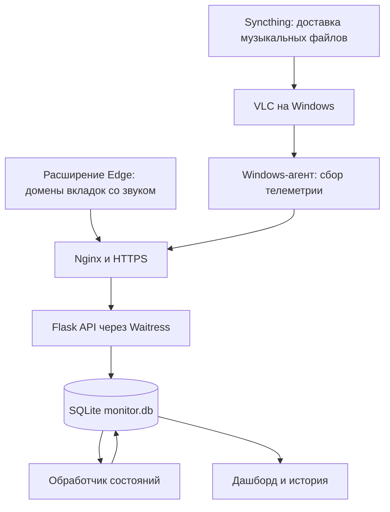

# RESONANCE Monitor

## Как я дошёл от Telegram-алармов до своей панели контроля музыки

RESONANCE я делаю для контроля музыки и состояния компьютеров в филиалах. Задача простая: открыть одну панель и понять, где есть музыкальный сигнал, где тишина, где выключен звук, а где ПК вообще перестал выходить на связь.

Начиналось всё с алармов в Telegram. Потом мне понадобилась нормальная история, источники звука и общий обзор магазинов. Так проект вырос в отдельный дашборд.

Здесь я разбираю устройство проекта, его развитие и обслуживание. Текст написан по сохранившемуся коду и переписке. Самый ранний старт восстановлен по этим материалам: точной даты первой установки и полного исходника первого бота здесь нет.

Это репозиторий документации. Полный сервер, Windows-агент и расширение браузера сюда пока не включены. Клонирование этой папки не поднимает рабочую систему. Примеры запросов и конфигов помогают разобраться в архитектуре, а не заменяют отсутствующие исходники.

## Навигация

* [С чего всё началось и что менялось](docs/01-history.md)
* [Как работает вся цепочка](docs/02-architecture.md)
* [Как я обслуживаю и переношу сервер](docs/03-operations.md)
* [Что уже проверено и что осталось](docs/04-status.md)

## Зачем мне вообще эта система

Проверять каждый магазин вручную неудобно. Компьютер может быть онлайн, VLC запущен, а музыка при этом стоять на паузе. Или Windows играет звук, но выбрано не то устройство вывода. Или браузер запущен, но нужная вкладка давно закрыта.

Поэтому я разделяю несколько разных вопросов:

| Что хочу узнать | На что смотрю |
| --- | --- |
| Жив ли агент | Когда сервер получил последний heartbeat |
| Есть ли программный аудиосигнал | Аудиосессии, сигнал, mute и громкость |
| Что делает VLC | Состояние плеера и его собственная громкость |
| Откуда звук в Edge | Домены вкладок со звуком, присланные расширением |
| Работает ли доставка музыки | Состояние Syncthing и наличие музыкальной папки |
| Когда началась проблема | История изменений состояния |

Наличие сигнала в Windows не доказывает, что физические колонки слышны в зале. Кабель, усилитель, выбранный аудиовыход и сами колонки могут подвести отдельно. Поэтому формулировка в панели у меня аккуратная: «Есть музыкальный сигнал».

## Общая схема

Syncthing доставляет файлы. VLC их воспроизводит. Агент наблюдает состояние. Сервер принимает отчёты и рассчитывает статусы. Эти роли я не смешиваю: исправный Syncthing ещё не означает, что музыка сейчас играет.

## Стек

| Часть | Что использую |
| --- | --- |
| Компьютер филиала | Windows, PowerShell-агент |
| Музыкальные файлы | Syncthing |
| Локальное воспроизведение | VLC |
| Источник звука в браузере | Расширение Edge |
| Сервер | Python, Flask, Waitress |
| Хранилище | SQLite, monitor.db |
| Внешний доступ | Nginx, HTTPS |
| Фоновые процессы | systemd |
| Первые уведомления | Telegram Bot API |
| Текущий основной интерфейс | Веб-панель и история событий |

## Почему я ушёл от Telegram как основного интерфейса

Telegram удобен для первого аларма. Но для постоянного контроля мне нужна сводка: какой магазин, какой компьютер, что было до сбоя, сколько длился перерыв и восстановилась ли связь.

Поэтому отправку в Telegram я отключил, а сбор данных и обработку событий оставил работать. В текущей схеме основная информация находится в дашборде. Старые Telegram-модули описаны как история проекта, включать их для работы новой схемы не требуется.

## Как читать этот репозиторий

Сначала я советую пройти историю, потом архитектуру. К командам обслуживания лучше переходить после понимания того, где лежит база и какие службы реально используются.

Все адреса вида `monitor.example.com`, имена `SHOP-PC-01` и другие значения в примерах условные. Рабочие токены, база магазинов, реальные адреса инфраструктуры и SSH-ключи сюда не входят.

Цель следующего этапа: довести проверенный пилот до стабильного развёртывания на 100+ компьютерах. Это цель проекта, а не заявление, что такой парк уже развёрнут и прошёл нагрузочные испытания.
